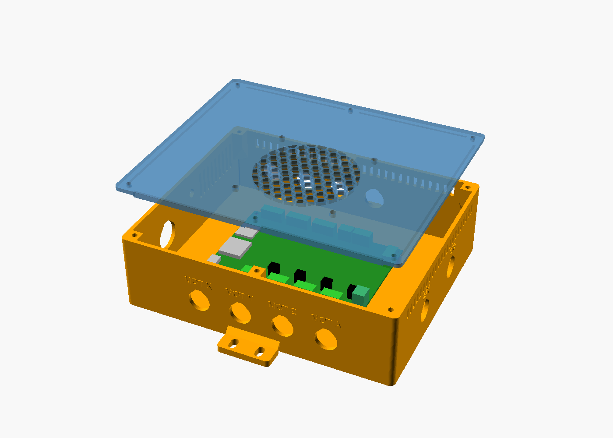

# wingcut-fluidnc

Open hardware for a **DIY 4-axis CNC hot-wire foam cutter** that cuts RC/UAV wing panels. It is driven by **[wingcut](https://github.com/andres/wingcut)** through **[FluidNC](https://github.com/bdring/FluidNC)** firmware.

This repo contains everything needed to build the machine and connect it to wingcut:
- a bill of materials,
- wiring tables,
- assembly and commissioning instructions,
- controller configs,
- 3D-printable enclosures.



| | |
|---|---|
| Cuts | wing panels up to **1250 mm** long (a 4 m wing = 4–5 panels), chord travel ≈1000 mm, height ≈300 mm |
| Wire | 0.4 mm Ni80Cr20, 1450 mm span, constant-force tension, MIG contact tips |
| Frame | 20×40 aluminium T-slot extrusion, MGN12 rails, GT2 belts (chord), T8×2 lead screws (vertical) |
| Electronics | FluidNC **4x** board (variant A) or **6x + 4× DM542T** (variant B); separate floating 36 V wire supply, PWM'd through an isolated SSR; 3-NC E-stop; USB isolator |
| Boxes | steel **power box** (mains) + **3D-printed controller box** (24 V) on the frame |
| Cost | US retail, recommended mix: **≈ $1,610** (A) / **≈ $1,780** (B) + shipping. AliExpress-heavy: ≈ $1,250–1,350 (A). Every screw counted, with two US buy links per line ([BOM](bom/bom.csv)). |

## Choose a variant

| | Variant A: FluidNC 4x | Variant B: FluidNC 6x + DM542T |
|---|---|---|
| Drivers | 4× TMC2209 on the board, set over UART | 4× external DM542T V4.0 (set by DIP switches) |
| Cost | lower (≈ −$170 in the US) | higher |
| Printed parts | `controller_case_4x` | `controller_case_6x` + `dm542t_rack` |
| Config | [config/fluidnc-4x-hotwire.yaml](config/fluidnc-4x-hotwire.yaml) | [config/fluidnc-6x-hotwire.yaml](config/fluidnc-6x-hotwire.yaml) |
| Pick it if | it's in stock (Elecrow: "notify me"); **recommended** | the 4x is unavailable, or you want external drivers |

Everything else (frame, wire heads, power box, cables, wingcut settings) is identical.

## Build order

1. **Read and order:** [docs/01-bom-wiring-assembly.md](docs/01-bom-wiring-assembly.md) §0–2, and [bom/bom.csv](bom/bom.csv). The `variant` column is A, B or A+B. Electronics ship slowest; order them first.
2. **Print the controller box:** [enclosure/README.md](enclosure/README.md). Measure your board and glands before printing (§4 there).
3. **Build the frame and towers:** 01 §4.1–4.8.
4. **Build the power box** (have an electrician check the mains part), then the **controller box**. Mount both on the bench beside the machine, **outside the wire span**: 01 §3 and §5.
5. **Test before firmware:** 01 §6.1–6.2.
6. **Flash and commission FluidNC:** [docs/02-firmware-commissioning.md](docs/02-firmware-commissioning.md) (a)–(d): upload the YAML, then bring up motors, limits, homing and tram. For variant B, also read [docs/02b-6x-variant.md](docs/02b-6x-variant.md).
7. **Wire-circuit tests on the dummy load**, including the **E-stop test**: 01 §6.3.
8. **String the wire:** 01 §4.9.
9. **Wire bring-up and kerf:** 02 (e) steps 4–6.
10. **Connect wingcut:** 01 §7 and 02 (f), with [config/wingcut-machine.toml](config/wingcut-machine.toml). Run a dry run and the Pause/STOP tests, then cut your first panel.

## Repository map

```
docs/01-bom-wiring-assembly.md   BOM, electrical architecture, wiring tables, mechanical + box assembly, tests, wingcut hook-up
docs/02-firmware-commissioning.md FluidNC flashing, bring-up, homing, tram, wire calibration, wingcut tests, troubleshooting (4x)
docs/02b-6x-variant.md           differences for the 6x + DM542T build
docs/audit.md                    independent audit record (all findings applied)
docs/research/                   background research: electronics, mechanics, CAM software, kits and costs
config/                          FluidNC configs (4x, 6x) and the wingcut machine.toml
bom/bom.csv                      orderable list with approximate USD line totals
enclosure/                       OpenSCAD sources, STLs and previews for the printed 24 V boxes
```

## Safety

- The power box carries **mains voltage**. Feed it from an RCD/GFCI outlet, and have the mains part built or checked by a qualified person.
- The E-stop cuts both PSUs and drives FluidNC's `estop_pin`. **If the PC or USB link fails mid-cut, the wire stays hot: never leave the machine unattended.**
- Hot-wire cutting polystyrene releases fumes. Use ducted extraction to outside and keep an extinguisher near. **Never cut PIR/PU foam.**
- A tensioned wire can snap. Wear safety glasses.

## Status

- **Design:** complete. Two independent audits have been applied.
- **Configs:** both FluidNC configs load with zero errors in the FluidNC v4.1.1 simulator, and every key in the wingcut TOML exists in wingcut's code.
- **Board dimensions** for the printed cases are verified from the boards' EasyEDA layouts.
- **Not yet built or cut on real hardware.** Values marked PLACEHOLDER (home heights, `tower_spacing`, heat, kerf) must be measured on your machine. Please open an issue with what you find.

## Licence

MIT (see [LICENSE](LICENSE)), same as wingcut. FluidNC is GPL-3.0; the configs here are plain data files for it.
